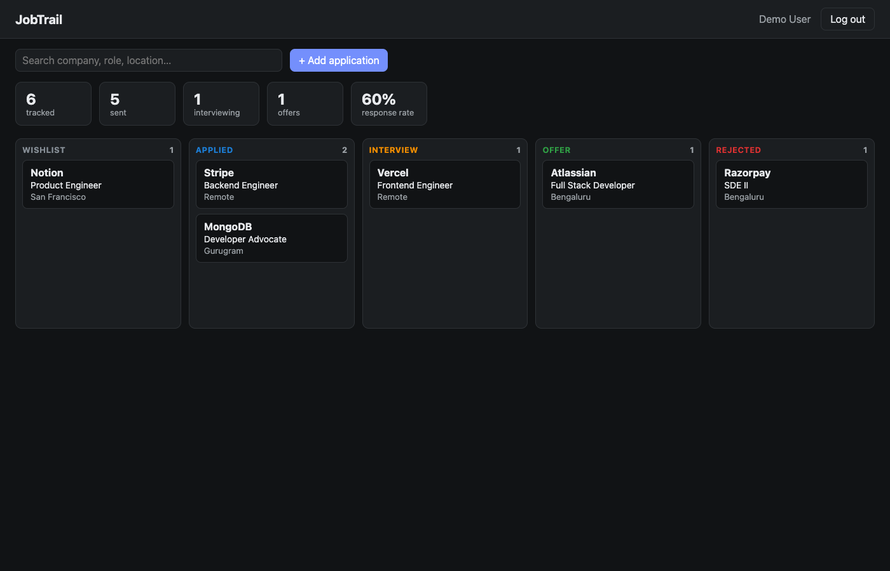

# JobTrail

A MERN job-application tracker. Log every role you're chasing, drag it across a
board from **wishlist → applied → interview → offer / rejected**, and see how your
search is going at a glance.



## Features

- **Accounts** – register, log in, log out; sessions survive page reloads.
- **Kanban board** – five status columns with native HTML5 drag-and-drop.
  Moves are optimistic and roll back if the server rejects them.
- **Full CRUD** – add, edit and delete applications in a modal form
  (company, role, status, location, job link, applied date, notes).
- **Search** – debounced search across company, role and location.
- **Live stats** – totals, interviews, offers and response rate, computed by a
  MongoDB aggregation pipeline.
- **Per-user data isolation** – every query is scoped to the logged-in user;
  touching someone else's record returns 404.
- **Dark mode** – follows the OS setting.

## Tech stack

| Layer    | Tech                                                                    |
| -------- | ----------------------------------------------------------------------- |
| Frontend | React 19, Vite 8, plain CSS                                             |
| Backend  | Node.js 22, Express 5                                                   |
| Database | MongoDB 8, Mongoose 9                                                   |
| Auth     | JWT in an httpOnly cookie, passwords hashed with Node's `crypto.scrypt` |
| Testing  | `node:test` + Supertest against a real MongoDB                          |
| DevOps   | Docker, docker-compose, GitHub Actions                                  |

## Project structure

```
jobtrail/
├── server/
│   ├── src/
│   │   ├── app.js              # Express app: middleware, routes, error handler
│   │   ├── index.js            # Connects to MongoDB and starts the server
│   │   ├── seed.js             # Demo account + sample data
│   │   ├── lib/auth.js         # JWT cookie helpers + requireAuth middleware
│   │   ├── models/             # User, Application (Mongoose schemas + validation)
│   │   └── routes/             # /api/auth, /api/applications
│   └── test/api.test.js
├── client/
│   └── src/
│       ├── api.js              # fetch wrapper
│       ├── App.jsx             # session check, auth vs. board
│       └── components/         # AuthForm, Board, ApplicationForm
├── Dockerfile                  # multi-stage: build client, run API serving it
├── docker-compose.yml          # app + MongoDB
└── .github/workflows/ci.yml    # tests + client build on every push
```

## Setup and installation

**Prerequisites:** Node.js 22.12+ and MongoDB (local install, Docker, or an Atlas URL).

```bash
git clone <repo-url> jobtrail && cd jobtrail

# API
cd server
npm install
cp .env.example .env        # edit MONGO_URL / JWT_SECRET if needed

# Client
cd ../client
npm install
```

No MongoDB installed? Start one with Docker:

```bash
docker run -d -p 27017:27017 --name jobtrail-mongo mongo:8
```

## Running the app

Run these in two terminals:

```bash
# Terminal 1: API on http://localhost:4000
cd server
npm run seed     # optional: demo@jobtrail.dev / password123 with sample data
npm run dev

# Terminal 2: React app on http://localhost:5173
cd client
npm run dev
```

Open http://localhost:5173. Vite proxies `/api` to the API, so the auth cookie
works without any CORS setup.

### With Docker (one command)

```bash
docker compose up --build
```

The app is served at http://localhost:4000 (the API also serves the built React app).
To load demo data: `docker compose exec app node src/seed.js`.

### Tests

```bash
cd server
npm test   # needs MongoDB; uses MONGO_URL or mongodb://127.0.0.1:27017/jobtrail_test
```

## API

All `/api/applications` routes require the auth cookie.

| Method | Route                          | Description                                      |
| ------ | ------------------------------ | ------------------------------------------------ |
| POST   | `/api/auth/register`           | Create account (name, email, password ≥ 8 chars) |
| POST   | `/api/auth/login`              | Log in                                           |
| POST   | `/api/auth/logout`             | Clear the session cookie                         |
| GET    | `/api/auth/me`                 | Current user                                     |
| GET    | `/api/applications?q=&status=` | List, with search and status filter              |
| GET    | `/api/applications/stats`      | Counts per status and response rate              |
| POST   | `/api/applications`            | Create                                           |
| PATCH  | `/api/applications/:id`        | Update (any subset of fields)                    |
| DELETE | `/api/applications/:id`        | Delete                                           |

Errors always come back as `{ "error": "message" }`: validation errors and bad
IDs return 400, unauthenticated requests 401, missing or not-yours records 404,
and a duplicate email 409.

## Bonuses (beyond the brief)

- **Authentication and authorization** – JWT in an httpOnly, SameSite cookie
  (not readable by page scripts, unlike `localStorage`), with ownership checks
  on every query.
- **Security hardening** – fields are whitelisted so clients can't reassign
  `user`; search input is regex-escaped (no ReDoS / regex injection); login
  rejects NoSQL-operator payloads like `{"email": {"$ne": null}}`; the job link
  must be `http(s)://` so `javascript:` URLs can't be stored; timing-safe
  password comparison; JSON body size is capped.
- **Automated tests** – 6 integration test cases covering auth, cross-user access,
  injection attempts, validation and the stats pipeline.
- **MongoDB aggregation** – the stats endpoint uses `$match` + `$group`.
- **Optimistic UI with rollback** for drag-and-drop status changes.
- **Docker** – a multi-stage image that runs as a non-root user, plus
  docker-compose with a persistent Mongo volume.
- **CI** – GitHub Actions runs the API tests against a MongoDB service container
  and builds the client on every push and PR.
- **Seed script** – a one-command demo account for reviewers.
- **Lean dependencies** – 4 runtime deps on the server. Built-in Node features
  replace nodemon (`node --watch`), dotenv (`--env-file`), bcrypt
  (`crypto.scrypt`) and Jest (`node:test`). Native `<dialog>`, `<input type="date">`
  and the HTML5 drag-and-drop API replace UI libraries.

### Deliberately left out

- **Pagination** – the list is capped at 500 items, which a personal job search
  won't reach. Add cursor pagination if that changes.
- **Rate limiting on auth routes** – this would be the first addition before a
  public deployment (`express-rate-limit`).
- **Client router** – the app has two screens, so conditional rendering is enough.
- **Touch drag-and-drop** – HTML5 drag events don't fire on touch screens. On
  mobile, change a card's status from the dropdown in its edit form.

## AI tool used

**Tool:** _Kiro_

## AI development experience

I used Kiro as a coding assistant for targeted, well-scoped tasks mostly
scaffolding and boilerplate while I drove the overall architecture, security
model, and data-flow design myself. I never gave it full-file prompts or asked
it to "build the app"; instead, I described small, bounded problems and reviewed
every line of output before committing. This let me move faster on the
mechanical parts and spend my time on decisions the tool can't make well:
authentication design, ownership scoping, input validation strategy, and the
drag-and-drop UX.

### Tasks where I used the AI tool

1. **Mongoose schema boilerplate** – I described the fields, types, and
   constraints I wanted for `User` and `Application`, and Kiro generated the
   schema definitions. I reviewed and added the `select: false` on
   `passwordHash` myself as the generated version exposed the hash in queries by
   default which would have been a data leak.

2. **Express error-handling middleware** – I asked it to generate a centralised
   error handler that converts Mongoose `ValidationError`, `CastError`, and
   MongoDB duplicate-key errors into consistent JSON responses.

3. **Dockerfile (multi-stage build)** – I prompted for a two-stage Dockerfile
   that builds the React client and then copies the output into a slim Node
   image. The initial output ran the container as `root`; I re-iterated and added `USER node`
   and also set `NODE_ENV=production` so Express enables its production
   optimisations.

4. **Integration test structure** – I asked Kiro to scaffold `node:test` +
   Supertest tests for the auth and applications routes. While prompting I made 
   sure that the generated tests covered happy paths, the cross-user ownership
   tests (`bob` trying to touch `alice`'s data), the NoSQL injection check
   (`{ "$ne": null }`), the regex-injection assertion (`q=.*` returning zero
   results), and the `javascript:` URL validation test.

5. **GitHub Actions CI workflow** – I asked it to generate a workflow that runs
   `npm test` against a MongoDB service container and builds the client on
   every push. The output used an outdated `actions/setup-node@v3` and didn't
   pin the MongoDB image tag; I updated the action to `v4`, pinned `mongo:8`,
   and added the `cache` key for faster CI runs.
